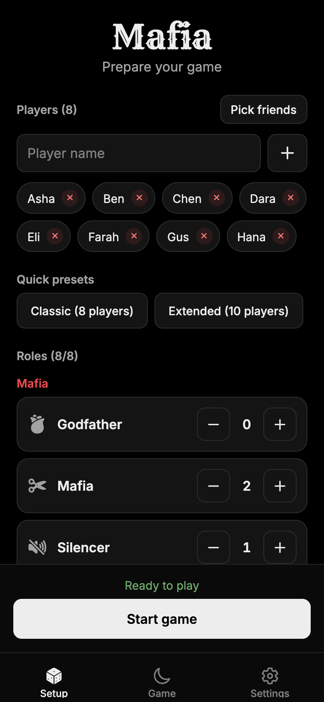
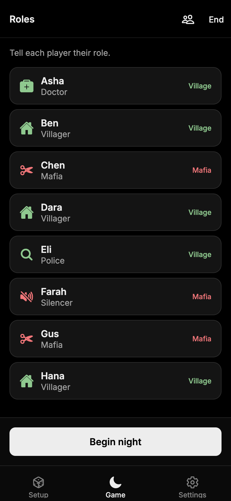

# Mafia Party

A moderator app for in-person Mafia games. One person, the narrator, keeps it open on their phone and the app handles everything they would otherwise track on paper: dealing roles, running each night, resolving kills and saves, the day vote and checking who has won.

It runs in any mobile browser. Players don't need the app; the narrator reads everything out loud.

<p align="center">
  
  
</p>
<p align="center"><sub>Setting up an 8-player game, then the dealt roles the narrator reads out.</sub></p>

## How a game goes

1. **Setup.** Add players by name or pick them from the saved friends list. Choose roles by hand, start from a preset (8, 10, 12 or 15 players), or tap Auto balance. The game needs 5 to 15 players, and the role count must match the player count.
2. **Roles.** Roles are shuffled and dealt. The narrator sees a list of every player with their role and team, and tells each player theirs privately.
3. **Night.** The app steps through every role that acts at night (Mafia, Doctor, Police, Bodyguard, Vigilante, Serial Killer, Silencer) and the narrator records each choice. Back undoes the last step. The results screen shows who died, who was saved, the police result and who is silenced.
4. **Day.** The night's deaths are announced, then a discussion timer runs. The narrator records the town's vote, or no elimination.
5. **End.** The app checks the win conditions after every night and every vote, then shows the winner and the full roster. Finished games are saved to History.

The game is saved in the browser, so refreshing the page or closing the tab resumes where you left off. The town board button in the header shows who is alive and dead without revealing roles, so it is safe to show the table.

## Roles

| Team | Roles |
|---|---|
| Mafia | Godfather (appears innocent to Police), Mafia, Silencer |
| Village | Villager, Police, Doctor, Bodyguard, Vigilante, Mayor (vote counts double) |
| Neutral | Jester (wins if voted out), Serial Killer, Survivor |

Every role, with tips for players and the narrator, is in Settings → Roles guide.

## Running it

Requires Node.js 22.18 or later (the shuffle check runs TypeScript directly).

```bash
npm install
npx expo start --web      # dev server, opens in the browser
npm run build:web         # production build into dist/
```

`dist/` is a static site; any static host works. `vercel.json` is set up for Vercel.

The project is an Expo (React Native) app, so it also runs on iOS and Android with `npx expo start --ios` / `--android`, but it is built and tested for the web.

## Checks

```bash
npx tsc --noEmit                  # types
npx biome check src App.tsx       # lint and format
node scripts/check-allocation.mjs # role shuffle is a fair permutation
```

## Customising

- **Friends list:** `src/data/friends.ts`
- **Roles and presets:** `src/data/roles.ts`
- **Night resolution order:** `src/utils/nightResolver.ts`
- **Win conditions:** `src/utils/winCondition.ts`
- **Colours:** `src/theme/colors.ts`

## Stack

Expo SDK 54, React Native with react-native-web, React Navigation, Zustand (persisted to localStorage), TypeScript, Biome.

## License

MIT. See [LICENSE](LICENSE).
